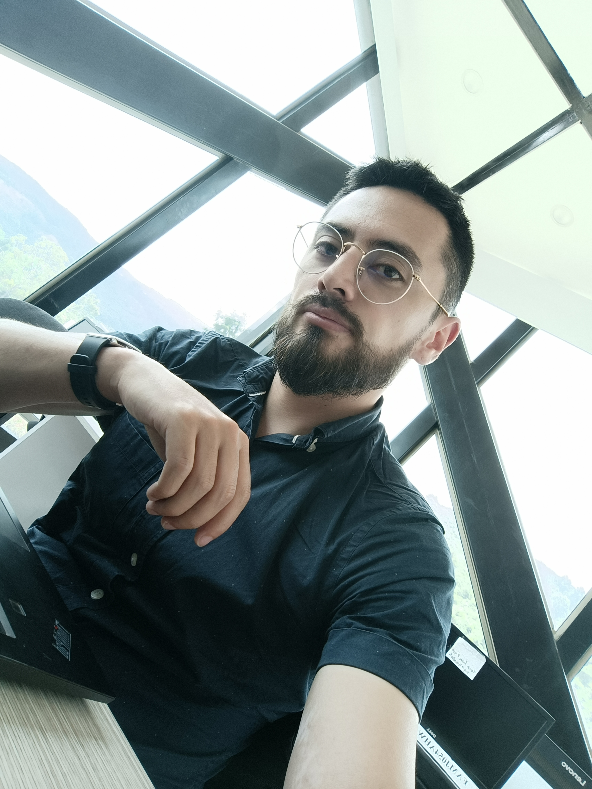
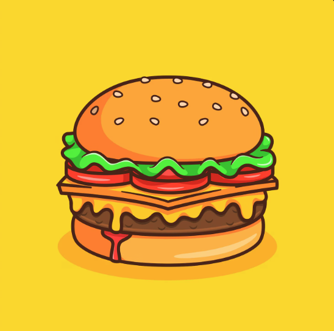
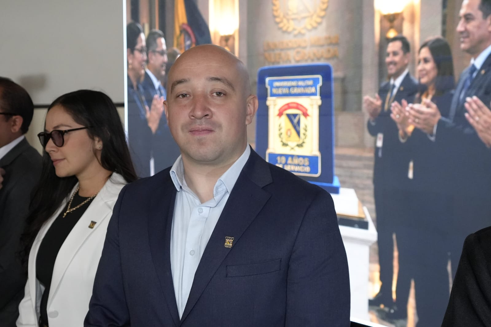
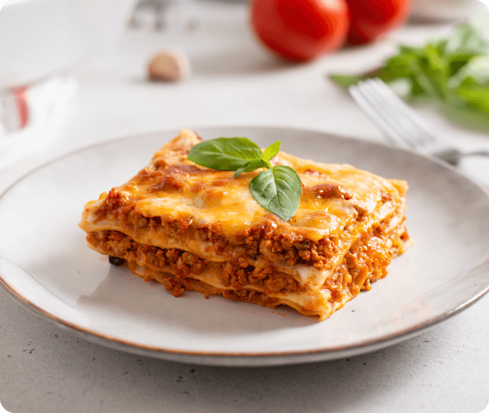
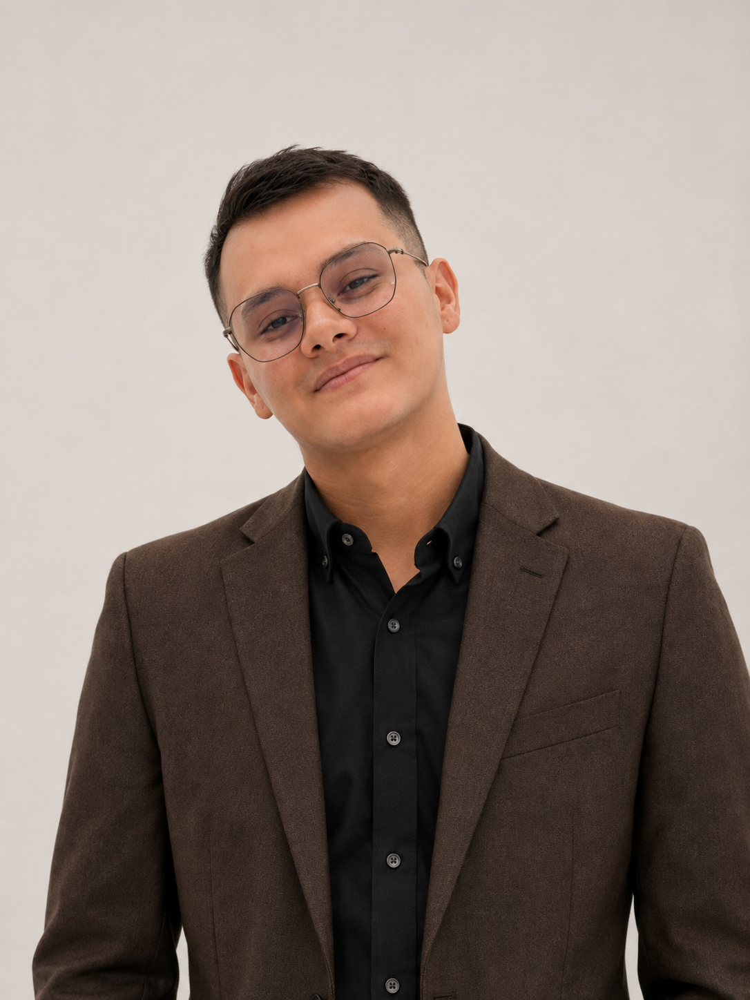

# Pixel-Dev-Squad
Repositorio - Programación para Videojuegos UNAD - Grupo 213027_3

## 🎮 Proyecto Etapa 3: Río Limpio Adventure: Misión Reciclaje
Videojuego educativo 2D (*Games for Change*) desarrollado en **Unity (`6000.3.20f1 LTS`)** enfocado en la separación de residuos sólidos en la fuente (Resolución 2184 de 2019) y la recuperación de un río andino para niños de básica primaria (7 a 12 años).

### 🕹️ Controles e Interacción Accesible (WCAG 2.2 / DUA)
* **Arrastrar y Soltar (*Drag & Drop*):** Arrastra el residuo activo hacia la caneca correspondiente.
* **Toque a Toque (*Click-to-Click*):** Haz clic sobre el residuo para seleccionarlo y luego haz clic en la caneca destino.
* **Teclado Numérico:** Usa las teclas **`1`** (Azul - Aprovechables), **`2`** (Roja - Especiales), **`3`** (Verde - Orgánicos) y **`4`** (Gris - No aprovechables / Trampa). Presiona **`R`** para reiniciar la partida.

### 📂 Estructura del Proyecto en Unity
* `Assets/Scenes/MainGameScene.unity`: Escena principal del centro de clasificación.
* `Assets/Scripts/`: Lógica C# comentada en inglés (`GameManager.cs`, `UIManager.cs`, `RecyclingBin.cs`, `WasteItemInteractable.cs`, `WasteItemData.cs`, `AudioManager.cs`).
* `Assets/Sprites/`: Recursos gráficos 2D de fondos, personaje, canecas y residuos.
* `Assets/Audio/`: Música de fondo (`Music/`) y efectos sonoros de acierto/error (`SFX/`).
* `Docs/`: Documentación técnica, declaración de IA, reporte de accesibilidad y sesión de crítica.

---

### Germán Andrés
* **Rol de la industria:** Programador Lead / Gestor de Repositorio
* **Ubicación:** Bogotá, Colombia
* **Perfil breve:** Productor Multimedia, Desarrollador front-end y webmaster con experiencia en migraciones de plataformas, gestión de código y despliegue de interfaces. Enfocado en aplicar la lógica de programación web a la estructuración de repositorios y mecánicas de videojuegos.

### Comida favorita

**Nombre Estudiante:** Eric Daniel Molina

**Rol:** Game Desinger

**Ubicación:** Colombia, Bogota D.C.

**Perfil:** Estudiante de septimo semestre de la UNAD, mi deseo es poder crear contenido gaming basado en la cultura colombiana, actualmente soy tecnico en mantenimiento de computadores en la UMNG y mi pasion son los animes como se supondra tambien los video juegos

### Comida favorito

## Integrante

**Nombre:** Oscar Agudelo

**Rol en la industria de videojuegos:**  
Artista Técnico

**Ubicación:**  
Quetame Cundinamarca

**Perfil breve:**  
Estudiante interesado en el desarrollo de videojuegos, integrando aspectos técnicos y artísticos mediante herramientas como Unity, diseño digital y trabajo colaborativo con control de versiones.

## Plato favorito

